<div align="center">

# Quantitative Research Lab

### Natural-gas forecasting · Storage-contract valuation · Credit-risk modelling · FICO scorecard bucketing

**A reproducible, test-covered research project: 4 modules, 21 registered experiments, 53 generated figures, a 26-page report and an interactive dashboard.**


</div>

---

> **The short version.** This repository started from four small quantitative-finance assignments. It did not stay that way.
> Each assignment was **audited, its methodological weaknesses were documented, and it was rebuilt as an independent research module**
> with proper train/test discipline, baselines, diagnostics, sensitivity analysis, automated tests and an experiment registry.
> The result is a small research codebase that asks *"how do we know this model is any good?"* for every model in it.

---

## Table of contents

1. [Project at a glance](#1-project-at-a-glance)
2. [From four assignments to a research project](#2-from-four-assignments-to-a-research-project)
3. [System architecture](#3-system-architecture)
4. [Repository map](#4-repository-map)
5. [Quick start](#5-quick-start)
6. [Data](#6-data)
7. [Module 1 · Natural-gas price forecasting](#7-module-1--natural-gas-price-forecasting)
8. [Module 2 · Storage-contract valuation (linear programming)](#8-module-2--storage-contract-valuation-linear-programming)
9. [Module 3 · Credit-risk modelling and expected loss](#9-module-3--credit-risk-modelling-and-expected-loss)
10. [Module 4 · FICO score bucketing (dynamic programming)](#10-module-4--fico-score-bucketing-dynamic-programming)
11. [Engineering: reproducibility, testing and CI](#11-engineering-reproducibility-testing-and-ci)
12. [Dashboard and reports](#12-dashboard-and-reports)
13. [Honest limitations and roadmap](#13-honest-limitations-and-roadmap)
14. [Skills demonstrated](#14-skills-demonstrated)
15. [The original assignment scripts (preserved)](#15-the-original-assignment-scripts-preserved)
16. [Origin, independence and disclaimer](#16-origin-independence-and-disclaimer)

---

## 1. Project at a glance

| | |
|---|---|
| **What it is** | A four-module quantitative research codebase covering commodities (forecasting + storage valuation) and retail credit (default modelling + score bucketing). |
| **What makes it a project** | Every module has a research question, a leakage-free evaluation design, baselines, diagnostics, written limitations, tests and reproducible outputs. |
| **Data** | 48 monthly natural-gas prices · 10,000 loan records (1,851 defaults, 18.5%) |
| **Methods** | Walk-forward time-series validation · Holt-Winters / SARIMA · LP optimisation (HiGHS) · logistic regression, trees, forests, gradient boosting · dynamic programming · WoE / information value |
| **Outputs** | 21 registered experiments · 53 PNG figures · CSV/JSON result tables · 11 Markdown reports · 26-page PDF · Streamlit dashboard |
| **Quality gates** | 13 automated tests · result-schema validation · GitHub Actions workflow · fixed seed (42) · SHA-256 hash of every dataset in the registry |

### Headline results

| Module | Question | Best approach | Measured result | The honest caveat |
|---|---|---|---|---|
| **Forecasting** | Which model predicts next month's gas price best, using only the past? | **Holt-Winters** | MAE **0.184** (price units), **67% lower** than seasonal-naive and **77% lower** than a historical-mean baseline | Only 48 months and one-step-ahead; no significance claim |
| **Storage** | What is a storage contract worth under perfect foresight? | **Linear program** | Base-case value **1,231** vs **−24** for doing nothing; physical limits cost more than fees | Prices are *assumed*, not observed; perfect foresight is an upper bound |
| **Credit risk** | Can we predict default and quantify expected loss? | **Logistic regression** | Held-out ROC-AUC **0.999998**, 0 false positives, 4 false negatives in 2,500 loans | Near-perfect scores are a **red flag** about the data, not a victory (see §9) |
| **FICO bucketing** | What are the best 10 risk buckets for a FICO score? | **Dynamic programming** | Highest held-out log-likelihood (**−1086.1**) vs −1090.7 (equal-width) and −1098.8 (equal-frequency) | Top buckets are noisy; stability is only checked on one split |

<p align="center">
  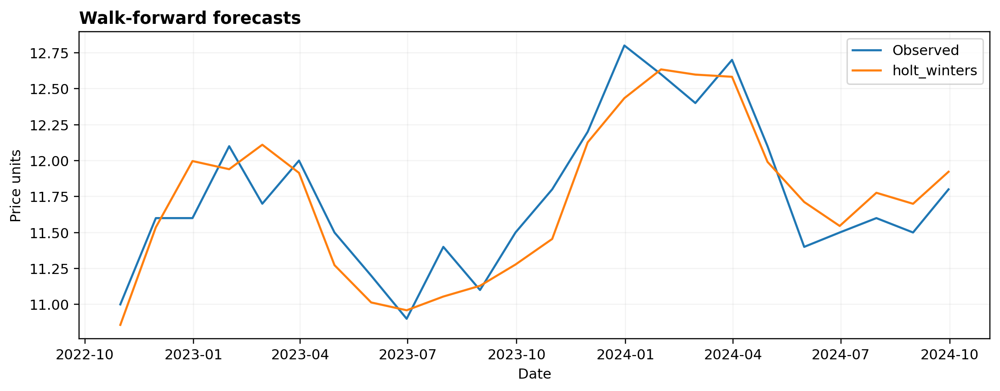
  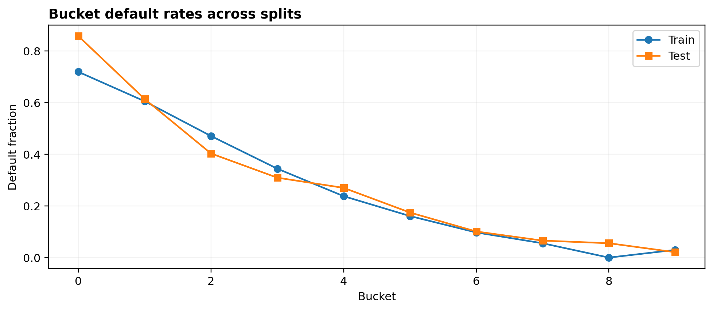
</p>
<p align="center"><em>Left: out-of-sample walk-forward forecasts track the observed series. Right: FICO bucket default rates generalise from train to held-out borrowers.</em></p>

### How to read this repo

| You have… | Read |
|---|---|
| **2 minutes** | This section + [`RESULTS.md`](RESULTS.md) |
| **10 minutes** | Sections 7–10 below (each module: question → method → results → caveats) |
| **30 minutes** | The [26-page PDF](reports/JPMORGAN_QUANTITATIVE_RESEARCH_FINAL_REPORT.pdf), then run the dashboard |
| **To verify claims** | [`results/experiment_registry.csv`](results/experiment_registry.csv) + `python -m pytest -q` |

---

## 2. From four assignments to a research project

The starting point was four self-contained scripts (`task1_…` to `task4_…`). Each worked, but reading them critically revealed gaps that a real research setting would not tolerate. The project is the work of closing those gaps — and the original scripts are **kept untouched** so the before/after is auditable.

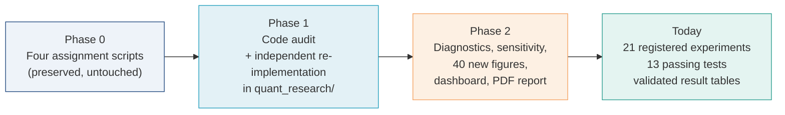

### What the audit found, and what was built in response

Findings below are from [`reports/INITIAL_AUDIT.md`](reports/INITIAL_AUDIT.md) and were re-verified by running the original scripts.

| Task | Weakness found in the original | What this project does instead |
|---|---|---|
| **1 · Gas prices** | Trend and seasonality were fitted on **all 48 months**, and the plotted "interpolation" passes through the data points, so it says nothing about predictive accuracy. No holdout, no baselines, no uncertainty. | **Expanding-window walk-forward evaluation** of 6 models on 24 genuinely out-of-sample months, with a test proving no forecast uses future data. |
| **2 · Storage contract** | Same-day injection and withdrawal handled with `if / elif` (the withdrawal is silently dropped); `list.index` matches only the *first* of repeated dates; infeasible operations are skipped with a printed message instead of an error. | A validated `Contract` object that **raises on invalid schedules**, an exact cash-flow valuer, and a **linear program** that finds the best possible schedule, with 7 stress scenarios. |
| **3 · Loan default** | Model trained **and scored on the same 10,000 rows**; AUC computed from hard 0/1 predictions rather than probabilities (it reported 0.9925). No calibration or cross-validation. | Stratified **held-out split**, probability-based metrics, 5-fold CV, calibration, PR curves, permutation importance, **LGD sensitivity**, and an explicit warning about the near-perfect scores. |
| **4 · FICO buckets** | Bucket edges were inclusive on both sides (boundary scores counted twice), and the output contained a degenerate **[752–753] bucket with just 22 borrowers**. Scored on training data only. | **Train-only fitting**, half-open intervals `[low, high)`, a **minimum bucket population**, held-out log-likelihood, WoE / IV and a train-vs-test stability check. |

The common thread: **make every claim falsifiable.** If a number appears in this README, there is a CSV in `results/` it came from and a command that regenerates it.

---

## 3. System architecture

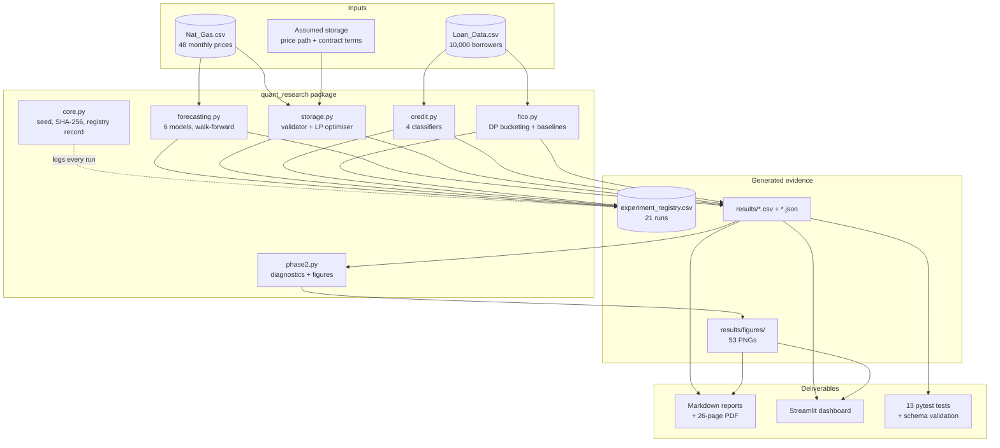

**Design principles**

1. **Separation of concerns:** research code in `quant_research/`, orchestration in `scripts/`, evidence in `results/`, narrative in `reports/`.
2. **Evidence-first:** figures and reports are generated *from* result tables, never hand-drawn or hand-typed.
3. **Preservation:** original assignment code is read-only history, not overwritten.
4. **Honesty by construction:** every module ships with its caveat, and the caveats flow automatically into the reports and PDF.

---

## 4. Repository map

```text
jpmc_quant_research_certification/
│
├── 📦 quant_research/                 ← the research package (independent implementations)
│   ├── core.py                          seed, dataset SHA-256, experiment-record helper
│   ├── forecasting.py                   6 models · expanding-window evaluation
│   ├── storage.py                       Contract · value_schedule() · optimize_hindsight() (LP)
│   ├── credit.py                        4 classifiers · stratified holdout · pipelines
│   ├── fico.py                          dp_edges() · equal-width / frequency / quantile baselines
│   └── phase2.py                        CV, calibration, WoE/IV, sensitivity, 40 diagnostic figures
│
├── 🧭 scripts/                        ← one-command entry points
│   ├── run_all_experiments.py           run the 4 modules → results/ + registry
│   ├── generate_all_figures.py          build all diagnostic figures
│   ├── generate_all_reports.py          write the Markdown reports + PDF
│   └── validate_all_results.py          schema-check every core table and JSON
│
├── 🧪 tests/                          ← 13 tests (property-style invariants)
│   ├── test_research.py
│   └── test_phase2.py
│
├── 📊 results/                        ← all generated evidence
│   ├── experiment_registry.csv          21 runs · seeds · hashes · versions · metrics
│   ├── research_summary.json
│   ├── forecasting/  storage/  credit_risk/  fico/      CSV + JSON result tables
│   └── figures/
│       ├── forecasting/   (9)   storage/ (9)   credit_risk/ (12)   fico/ (10)
│       └── …plus 13 Phase-1 summary figures
│
├── 📝 reports/                        ← narrative outputs
│   ├── FORECASTING_… STORAGE_VALUATION_… CREDIT_RISK_… FICO_SEGMENTATION_…  (_RESEARCH_REPORT.md)
│   ├── FINAL_RESEARCH_REPORT.md   INITIAL_AUDIT.md   PHASE_2_*.md   TEST_REPORT.md
│   └── JPMORGAN_QUANTITATIVE_RESEARCH_FINAL_REPORT.pdf   (26 pages, figure-embedded)
│
├── 🖥️ dashboard/app.py                 ← read-only Streamlit explorer
├── 📚 docs/                           ← architecture, methodology, data dictionary, limitations
│
├── 🗃️ task1_gas_price_estimation/      ┐
├── 🗃️ task2_storage_contract_pricing/  │ original assignment scripts,
├── 🗃️ task3_loan_default_prediction/   │ preserved unchanged
├── 🗃️ task4_fico_bucketing/            ┘
│
├── ⚙️ .github/workflows/tests.yml      CI: pytest + full experiment run
├── Makefile  requirements.txt  requirements-dashboard.txt  pyproject.toml
└── RESULTS.md  RESEARCH_METHODOLOGY.md
```

---

## 5. Quick start

```bash
# 1. Environment
python3 -m venv .venv && source .venv/bin/activate
pip install -r requirements.txt
pip install reportlab tabulate          # only needed for the PDF / Markdown report step

# 2. Reproduce everything (≈ 20 seconds on a laptop)
python -m scripts.run_all_experiments    # runs the 4 modules, writes results/ + registry
python -m scripts.generate_all_figures   # 53 figures
python -m scripts.generate_all_reports   # module reports + 26-page PDF
python -m scripts.validate_all_results   # schema checks
python -m pytest -q                      # 13 tests

# 3. Explore interactively
streamlit run dashboard/app.py
```

Prefer `make`? `make experiments figures reports validate test` (and `make dashboard` to launch the explorer).

---

## 6. Data

| Dataset | Rows | Columns | Notes |
|---|---|---|---|
| `Nat_Gas.csv` | 48 | `Dates`, `Prices` | Month-end snapshots, 31 Oct 2020 → 30 Sep 2024 |
| `Task_3_and_4_Loan_Data.csv` | 10,000 | `customer_id`, `credit_lines_outstanding`, `loan_amt_outstanding`, `total_debt_outstanding`, `income`, `years_employed`, `fico_score`, `default` | 1,851 defaults (18.51%) · FICO range 408–850 · no missing values · no duplicate rows |

Input validation is enforced in code (positive income, binary target, no missing values, chronological dates, no duplicate dates), and `customer_id` is excluded from all predictors. The provenance of both datasets is not independently established, which is stated wherever it matters.

---

## 7. Module 1 · Natural-gas price forecasting

> **Research question:** Using only past prices, which model forecasts next month's natural-gas price most accurately?

### Method

The evaluation is an **expanding-window, one-step-ahead walk-forward test**. At each origin the model sees only earlier months, predicts the next one, then the window grows by one month.

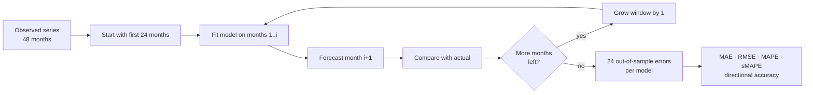

| Model | Idea | Role |
|---|---|---|
| Historical mean | Always predict the long-run average | Floor baseline |
| Seasonal naive | Predict the value from 12 months ago | Seasonality baseline |
| Moving average | Mean of last 3 months | Short-memory baseline |
| Linear trend | Extrapolate a fitted straight line | Trend-only baseline |
| **Holt-Winters** | Additive trend + additive 12-month seasonality | Candidate |
| **SARIMA(1,0,0)(0,1,0)₁₂** | Autoregression with seasonal differencing | Candidate |

Leakage protection is structural: the evaluation loop hands each model only `y[:i]`, so a forecast for month *i* cannot see month *i* or anything after it. A unit test (`test_forecast_uses_only_prefix`) checks that prefix contract on the forecasting function.

### Results (24 out-of-sample months, Oct 2022 → Sep 2024)

| Model | MAE ↓ | RMSE ↓ | MAPE % ↓ | Directional acc. |
|---|---:|---:|---:|---:|
| **Holt-Winters** | **0.184** | **0.219** | **1.57** | 65.2% |
| SARIMA | 0.297 | 0.359 | 2.51 | 60.9% |
| Moving average | 0.421 | 0.509 | 3.59 | 60.9% |
| Linear trend | 0.488 | 0.563 | 4.13 | 39.1% |
| Seasonal naive | 0.567 | 0.622 | 4.81 | 69.6% |
| Historical mean | 0.795 | 0.935 | 6.61 | 52.2% |

|  | 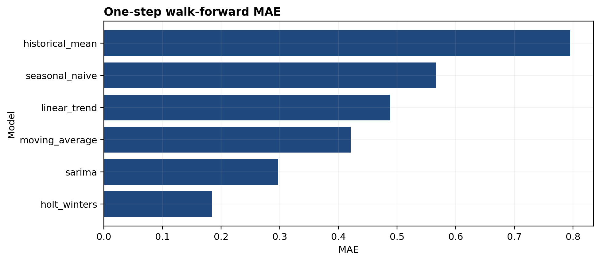 |
|:--:|:--:|
| *Best model's one-step forecasts vs observed prices.* | *Error ranking across all six models.* |
| 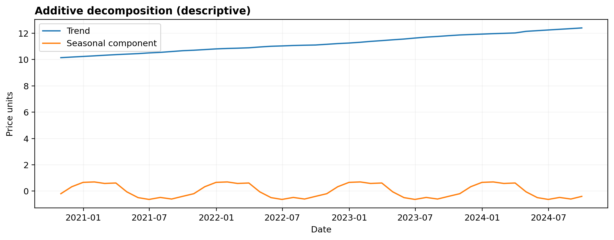 | 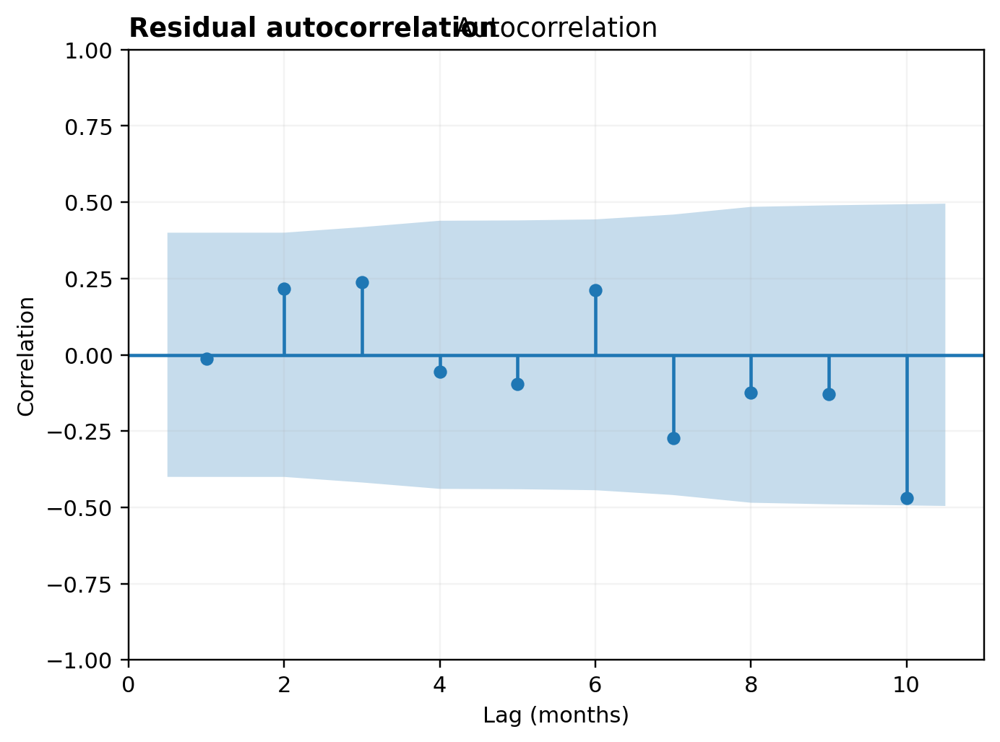 |
| *Descriptive trend + seasonal decomposition (period 12).* | *Residual autocorrelation: is there structure the model missed?* |

### What this tells us

- **Modelling both trend and seasonality matters.** Holt-Winters beats the trend-only line by 62% and the seasonal-only naive model by 67% on MAE. Neither component alone is enough.
- **Simple ≠ bad, but it has limits.** Seasonal-naive has the best *directional* accuracy (69.6%) yet the second-worst error magnitude, so getting the direction right is not the same as getting the level right. With only 23 direction checks, one extra hit moves the percentage by about 4 points, so that metric is noisy.
- **A descriptive error band** (±0.36, the 90th percentile of absolute one-step error) is plotted in `09_empirical_band.png`. It is deliberately labelled *not* a calibrated prediction interval, because it reuses the same errors it summarises.

<details>
<summary><b>More forecasting figures</b></summary>

| 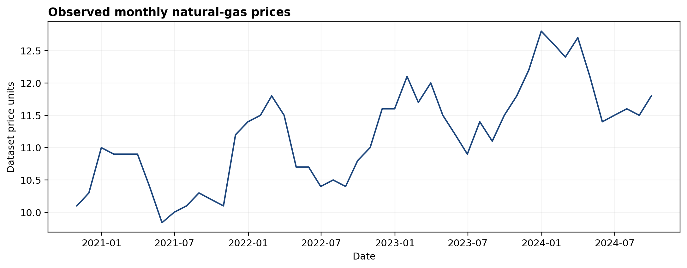 | 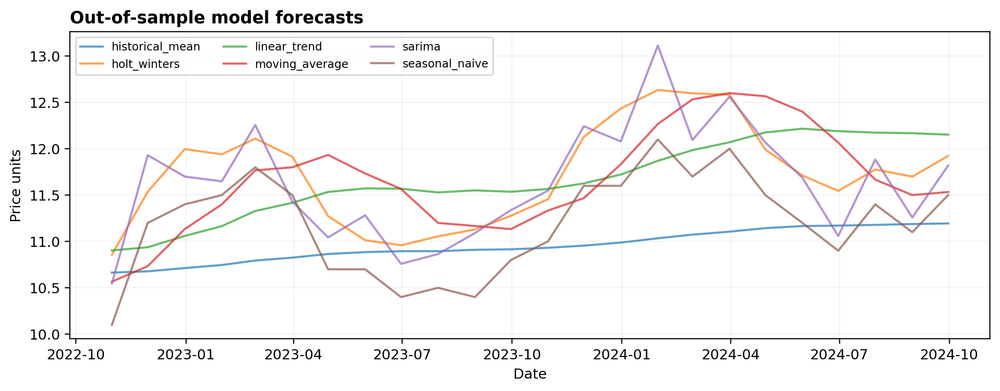 |
|:--:|:--:|
| *Observed monthly prices.* | *Every model's forecasts together.* |
| 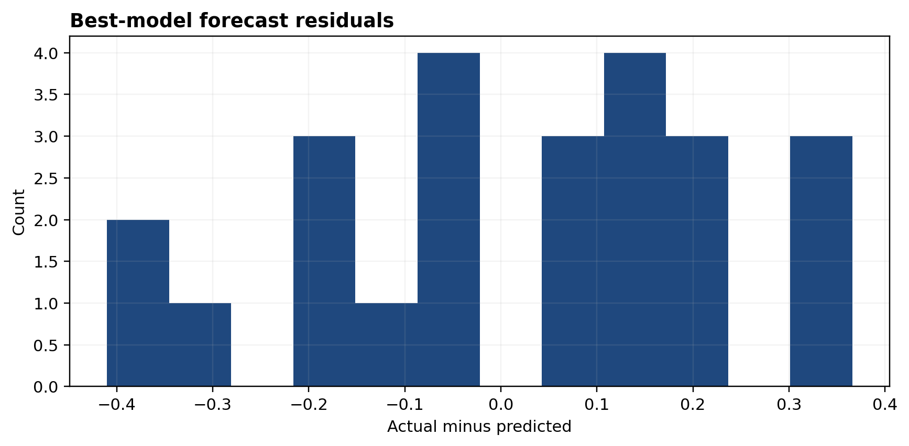 | 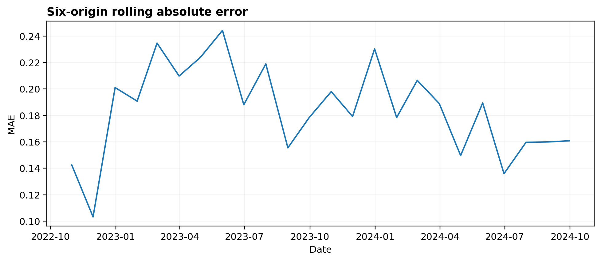 |
| *Residual distribution of the best model.* | *Six-origin rolling absolute error.* |

</details>

**Caveats.** 48 observations is small; only one-step horizons are tested; differences between models are descriptive, not statistically tested.

---

## 8. Module 2 · Storage-contract valuation (linear programming)

> **Research question:** What is a gas-storage contract worth if you operate it optimally, and which contract terms drive that value?

### Method

The contract is modelled as an exact cash-flow ledger with physical constraints, then optimised as a **linear program** solved with SciPy's HiGHS solver.

```math
\max_{i_t,\quad w_t} \sum_{t=1}^{T} \Big[ w_t (p_t - \phi) - i_t (p_t + \phi) - s \Big]
```

subject to

```math
I_t = I_0 + \sum_{\tau \le t} (i_\tau - w_\tau), \qquad 0 \le I_t \le C, \qquad I_T = I_{\text{terminal}}, \qquad 0 \le i_t \le \bar{i}, \quad 0 \le w_t \le \bar{w}
```

where $p_t$ is the price, $i_t$ and $w_t$ are injection and withdrawal volumes, $\phi$ is the per-unit transaction fee, $s$ is the storage fee per period, $C$ is capacity and $I_t$ is inventory.

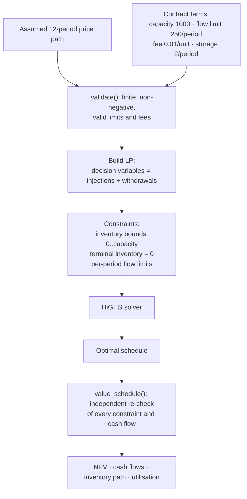

Note the two-layer design: the optimiser *proposes* a schedule, then a **separate** `value_schedule()` function independently re-validates and re-prices it. Optimiser bugs cannot silently produce an infeasible answer.

### Base-case optimal schedule

The LP buys in the four cheapest periods and sells in the four most expensive ones, filling and draining the facility at its 250-unit flow limit.

| 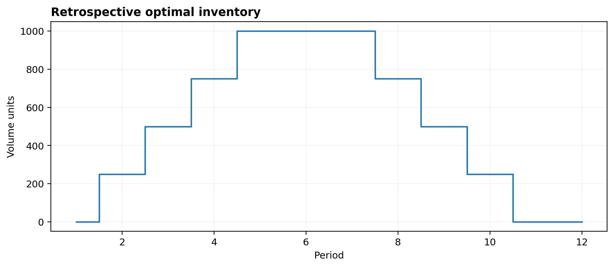 | 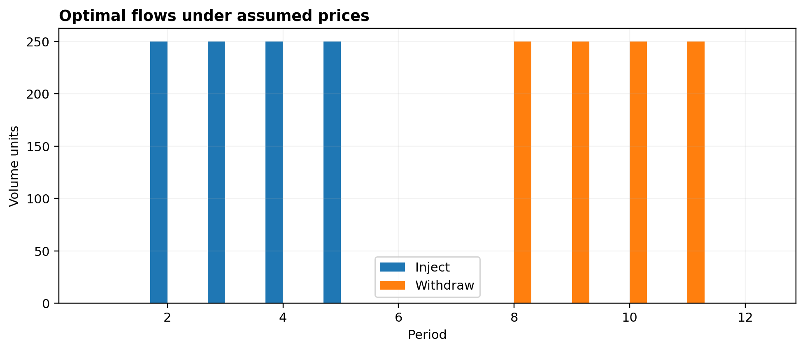 |
|:--:|:--:|
| *Inventory builds through period 5, then drains.* | *Inject in periods 2-5, withdraw in periods 8-11.* |
| 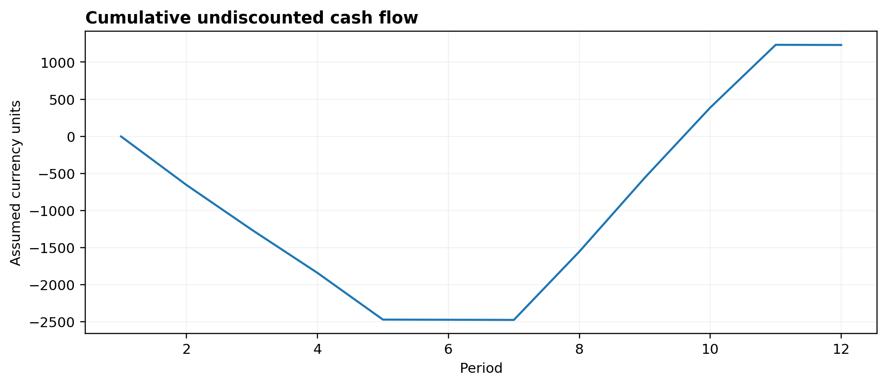 | 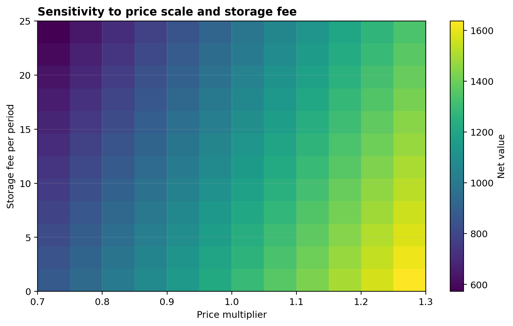 |
| *Cash is spent first, then recovered to a net 1,231.* | *Net value vs price level and storage fee.* |

### Scenario analysis

| Scenario | Net value | Δ vs base | Utilisation |
|---|---:|---:|---:|
| Base assumption | **1,231** | – | 50.0% |
| High prices (+20%) | 1,486 | +255 | 50.0% |
| Low prices (−20%) | 976 | −255 | 50.0% |
| Higher storage fee (2 → 15 / period) | 1,075 | −156 | 50.0% |
| Higher transaction fee (0.01 → 0.15) | 951 | −280 | 50.0% |
| Reduced capacity (1000 → 500) | 741 | −490 | 50.0% |
| Restricted withdrawal (250 → 100 / period) | 687 | −544 | 29.6% |
| *Do nothing (pays rent only)* | *−24* | *−1,255* | *0%* |

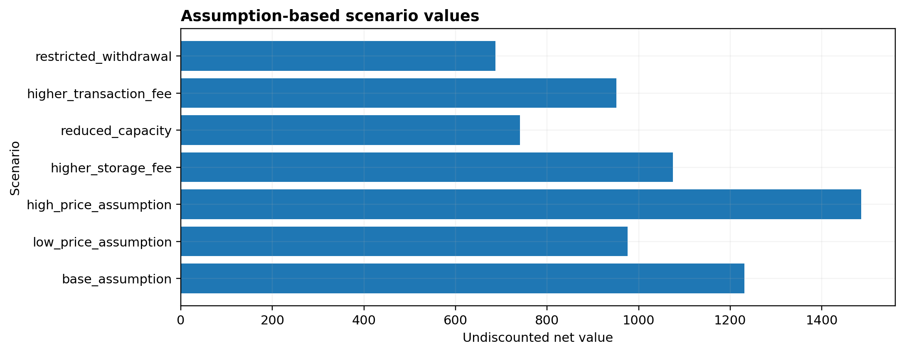

### What this tells us

- **Physical limits matter more than fees here.** A 7.5× increase in the storage fee costs 156; halving capacity costs 490; throttling withdrawals costs 544. Operational flexibility is worth more than a cheap rental rate in this setup.
- **Price scaling is linear in the optimum:** ±20% on prices moves value by exactly ±255, consistent with the same schedule remaining optimal.
- **A zero-spread price curve has no value:** a test (`test_lp_zero_spread_not_profitable`) confirms the optimiser doesn't invent profit from flat prices.

**Caveats.** The 12-period price path is an **illustrative assumption**, not a market forward curve. The LP has perfect foresight, so its value is an *upper bound* that a real operator cannot realise. Value is undiscounted. The LP technically allows simultaneous injection and withdrawal, though positive fees make that uneconomic.

---

## 9. Module 3 · Credit-risk modelling and expected loss

> **Research question:** Can we predict borrower default, and what is the resulting expected loss, under honest evaluation?

### Method

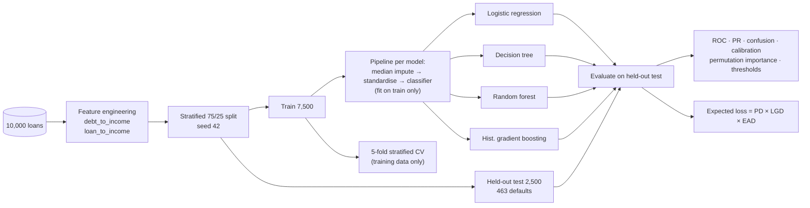

Preprocessing lives **inside** the pipeline, so imputation and scaling statistics are learned from training data only, which prevents preprocessing leakage.

**Features (5):** `credit_lines_outstanding`, `debt_to_income`, `loan_to_income`, `years_employed`, `fico_score`.

### Results (held-out test set, 2,500 loans)

| Model | ROC-AUC | PR-AUC | Precision | Recall | F1 | Brier ↓ | Log-loss ↓ |
|---|---:|---:|---:|---:|---:|---:|---:|
| **Logistic regression** | **0.999998** | 0.99999 | 1.000 | 0.991 | 0.996 | 0.0028 | 0.0128 |
| Hist. gradient boosting | 0.99993 | 0.99968 | 0.989 | 0.991 | 0.990 | **0.0026** | **0.0088** |
| Random forest | 0.99979 | 0.99913 | 0.989 | 0.983 | 0.986 | 0.0059 | 0.0215 |
| Decision tree | 0.99766 | 0.98629 | 0.973 | 0.918 | 0.944 | 0.0135 | 0.0688 |

Logistic regression's confusion matrix at the 0.5 threshold: **2,037 true negatives · 0 false positives · 4 false negatives · 459 true positives.**

| 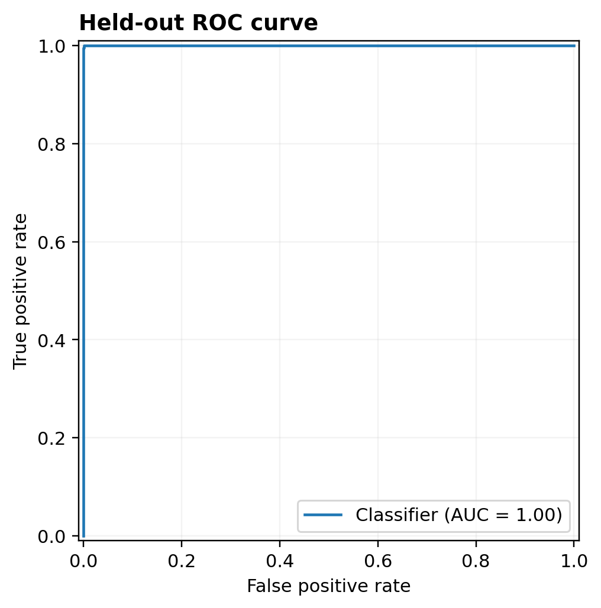 | 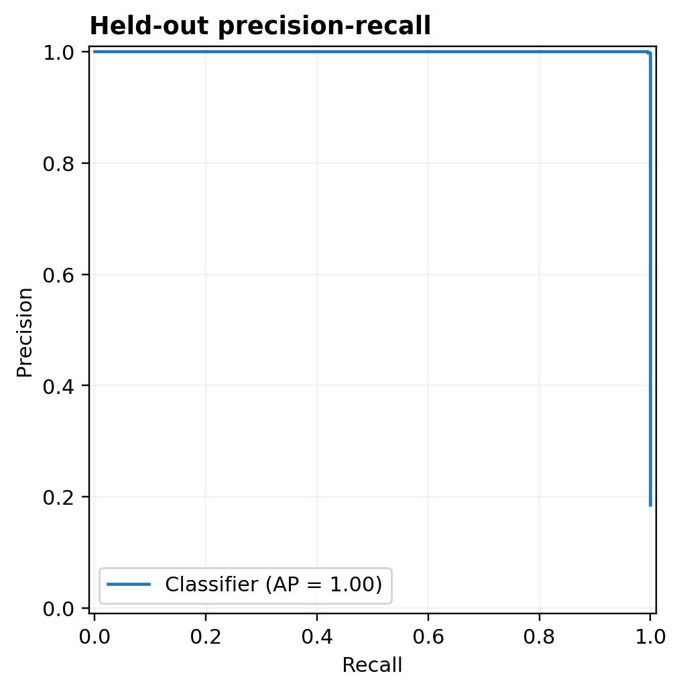 |
|:--:|:--:|
| *Held-out ROC curve.* | *Held-out precision-recall curve.* |
| 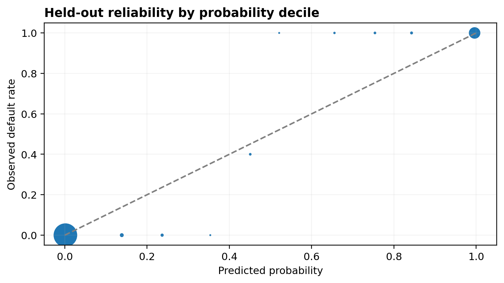 | 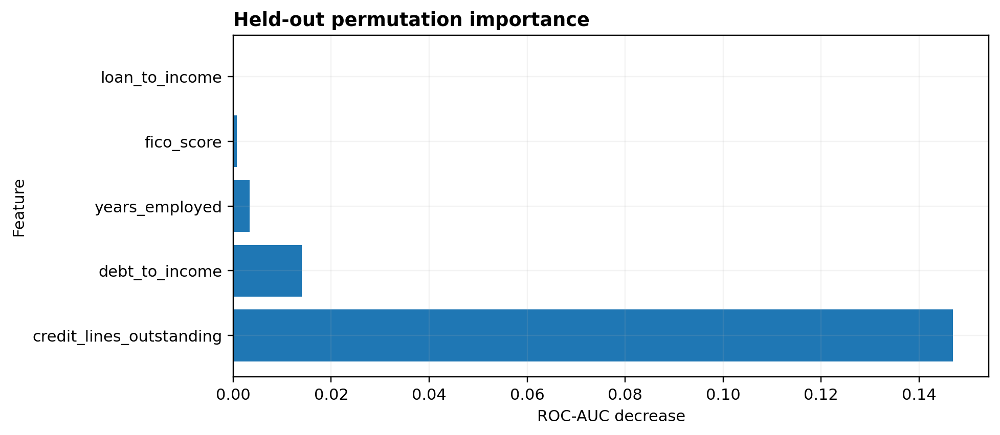 |
| *Reliability diagram: predictions cluster at 0 and 1.* | *Which features the model actually relies on.* |

### Expected loss and the recovery-rate assumption

```math
\text{Expected Loss} = \text{PD} \times \text{LGD} \times \text{EAD}, \qquad \text{LGD} = 1 - \text{recovery rate}
```

PD comes from the model, EAD is the observed `loan_amt_outstanding`, and **LGD is an assumption**, because the data contains no recovery information. Instead of hiding that, the project sweeps it:

| Assumed LGD | 10% | 30% | 50% | 70% | 90% *(= 10% recovery)* |
|---|---:|---:|---:|---:|---:|
| Total expected loss (2,500 test loans) | 206,947 | 620,840 | 1,034,733 | 1,448,626 | **1,862,519** |

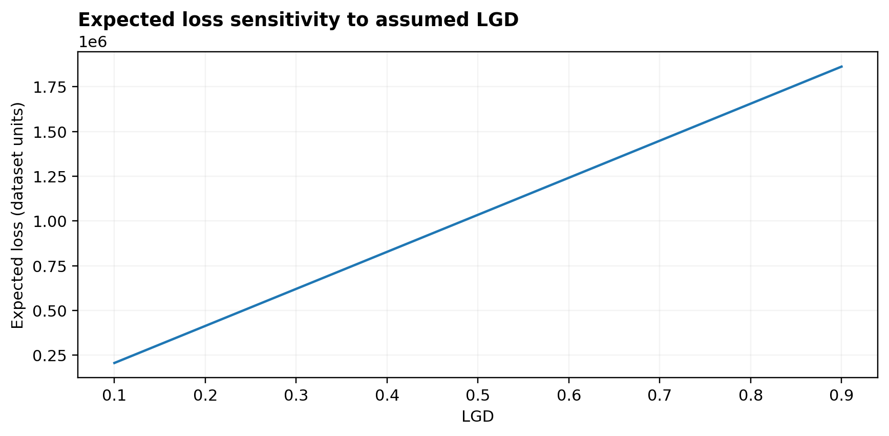

### What this tells us, including the uncomfortable part

- **ROC-AUC of 0.999998 is not a success story, it is a warning.** Real credit data does not separate this cleanly. Plausible explanations include a synthetic or heavily engineered target, or a feature that nearly encodes the outcome. The data provenance can't confirm which. The project says so in the report, in `model_summary.json`, and here, rather than presenting the number as a result.
- **One feature dominates.** Permutation importance shows `credit_lines_outstanding` costs **0.147 ROC-AUC** when shuffled, versus 0.014 for debt-to-income and under 0.001 for FICO score. Default in this dataset is driven almost entirely by credit lines, which is another sign of an unusually clean data-generating process.
- **The ranking depends on the metric.** Logistic regression wins on discrimination (ROC-AUC); gradient boosting wins on probability quality (Brier, log-loss). Choosing a model means choosing a metric.
- **Cross-validation agrees:** mean 5-fold ROC-AUC on training data is **0.999987**, so the held-out result is not a lucky split.
- **Threshold choice is a business decision.** At 0.45 the F1 peaks at 0.9989 (recall 1.0, precision 0.998). That sweep is plotted for illustration, and selecting a threshold on test data would be leakage in practice.

<details>
<summary><b>More credit-risk figures</b></summary>

| 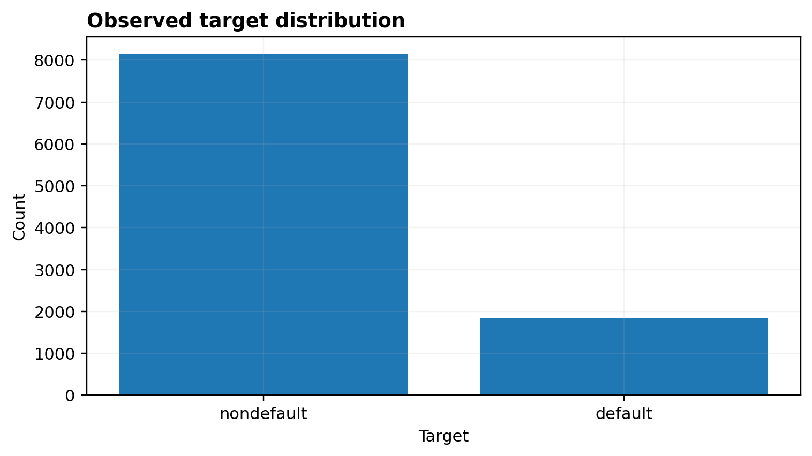 | 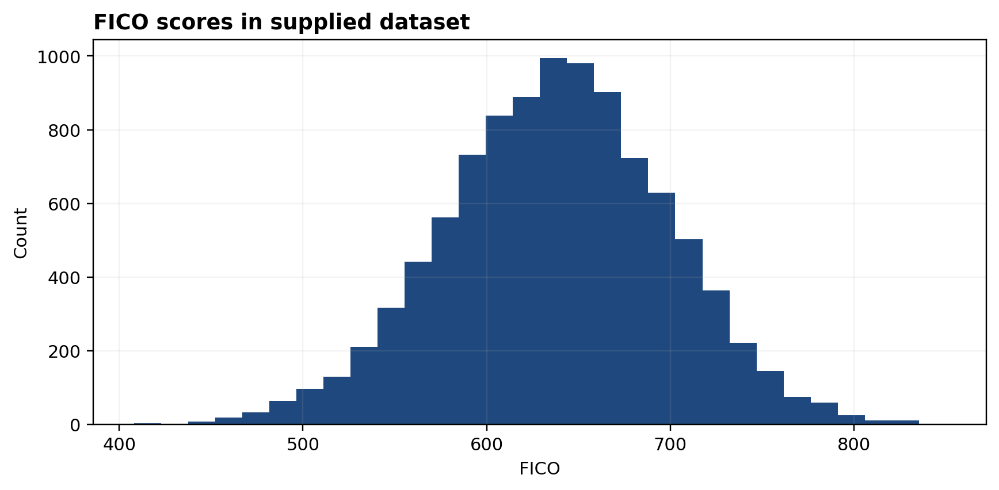 |
|:--:|:--:|
| *Target distribution (18.5% default).* | *FICO scores in the sample.* |
| 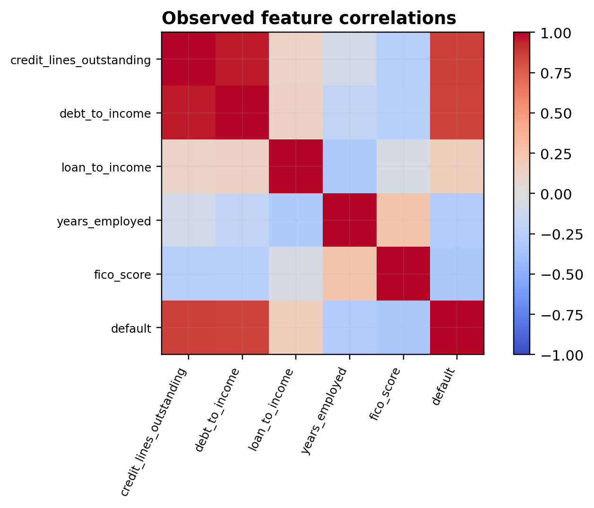 | 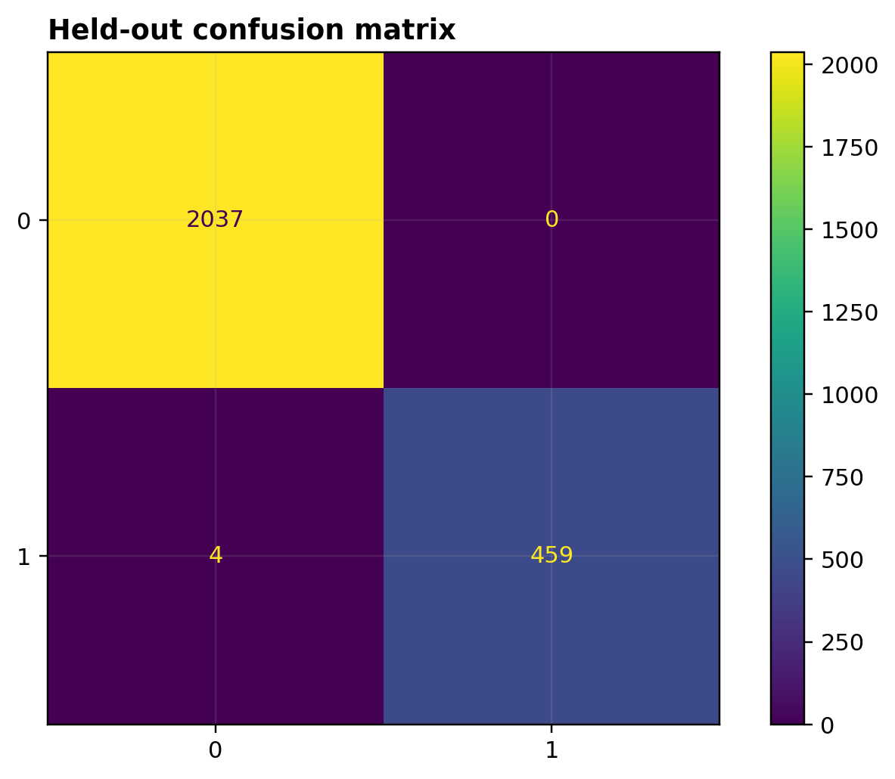 |
| *Feature correlation matrix.* | *Held-out confusion matrix.* |
| 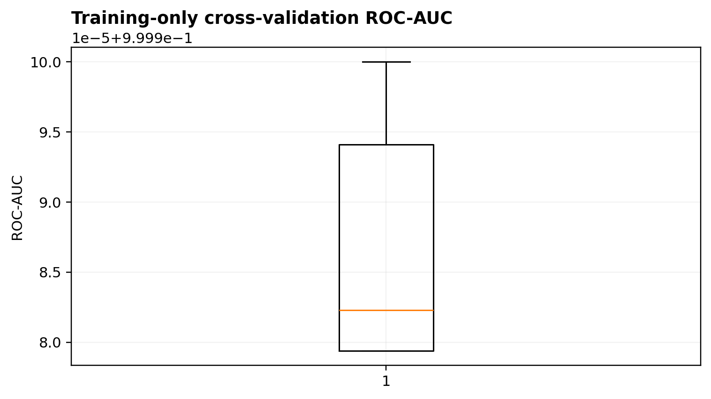 | 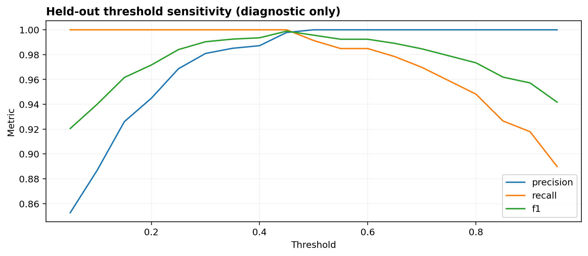 |
| *5-fold CV ROC-AUC (training only).* | *Precision / recall / F1 vs threshold.* |

</details>

**Caveats.** Provenance unverified; no temporal or external validation; LGD assumed; performance claims do not transfer to real lending.

---

## 10. Module 4 · FICO score bucketing (dynamic programming)

> **Research question:** How should continuous FICO scores (300-850) be cut into 10 ordered risk buckets so that each bucket's default rate is as well-explained as possible, and do those buckets generalise?

### Method

Each candidate bucket is scored by the **Bernoulli log-likelihood** of its observed default rate, which rewards buckets that are internally homogeneous in risk. The best 10-bucket partition is found *exactly* with dynamic programming over the distinct observed score values.

```math
\mathrm{LL}(i,j) = k \ln\frac{k}{n} + (n-k)\ln\left(1 - \frac{k}{n}\right)
```

```math
\mathrm{dp}[b][j] = \max_{i<j \text{ and } n(i,j) \ge n_{\min}} \left( \mathrm{dp}[b-1][i] + \mathrm{LL}(i,j) \right)
```

where $n$ and $k$ are the borrowers and defaults in the candidate bucket $(i,j]$, and $n_{\min}=50$ is the minimum bucket population.

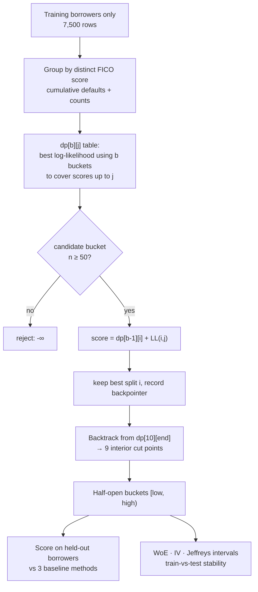

Four methods are compared, all fitted on training scores only and scored by held-out log-likelihood: **equal-width**, **equal-frequency**, **quantile**, and **dynamic programming**.

### Method comparison (held-out)

| Method | Held-out log-likelihood ↑ | Smallest training bucket | Monotone default rate? |
|---|---:|---:|:--:|
| **Dynamic programming** | **−1086.07** | 96 | no |
| Equal-width | −1090.66 | **1** | yes |
| Equal-frequency | −1098.82 | 712 | yes |
| Quantile | −1098.82 | 712 | yes |

*(Equal-frequency and quantile coincide, as expected: the quantile edges are the same cut points.)*

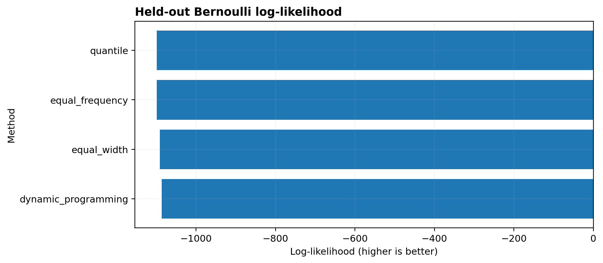

### The learned scorecard

| Bucket | FICO range | Train n | Train default | Test n | Test default |
|---:|---|---:|---:|---:|---:|
| 0 | < 493 | 96 | 71.9% | 14 | 85.7% |
| 1 | 493 – 521 | 162 | 60.5% | 44 | 61.4% |
| 2 | 522 – 554 | 389 | 47.0% | 139 | 40.3% |
| 3 | 555 – 580 | 657 | 34.4% | 207 | 30.9% |
| 4 | 581 – 610 | 1,115 | 23.8% | 378 | 27.0% |
| 5 | 611 – 649 | 1,885 | 16.1% | 648 | 17.4% |
| 6 | 650 – 696 | 1,945 | 9.7% | 664 | 10.1% |
| 7 | 697 – 732 | 830 | 5.5% | 274 | 6.6% |
| 8 | 733 – 741 | 118 | 0.0% | 36 | 5.6% |
| 9 | ≥ 742 | 303 | 3.0% | 96 | 2.1% |

|  | 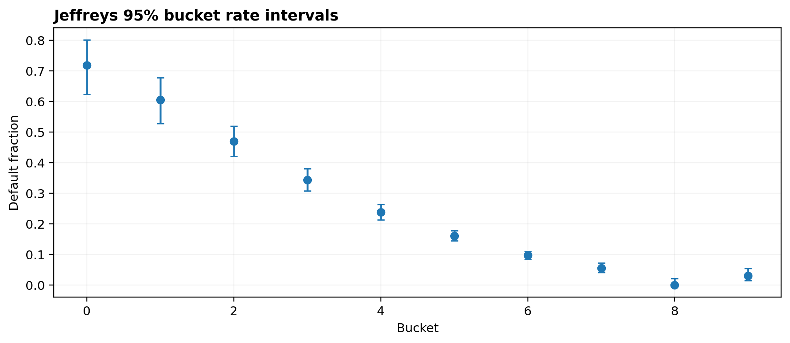 |
|:--:|:--:|
| *Default rate by bucket, train vs held-out test.* | *95% Jeffreys intervals show how uncertain each bucket's rate is.* |
| 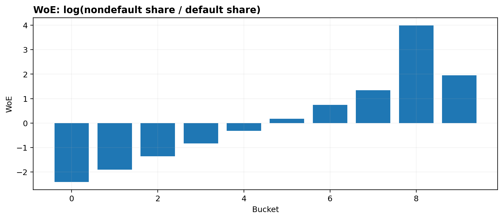 | 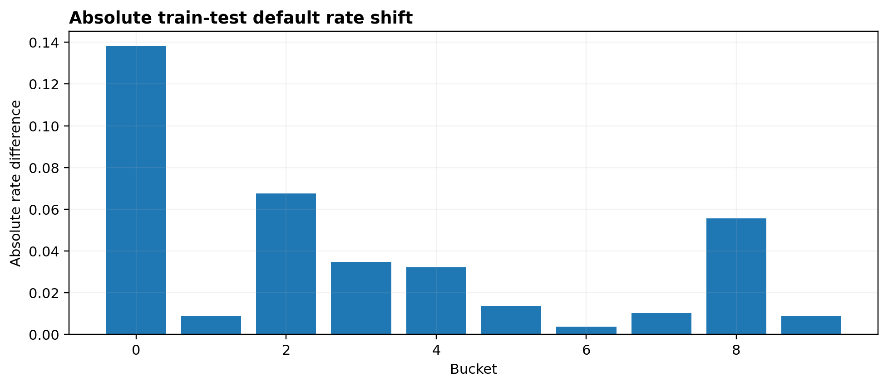 |
| *Weight of evidence per bucket.* | *Absolute train-to-test shift in default rate.* |

### Original vs rebuilt: the [752–753] bucket

| | Original assignment | This project |
|---|---|---|
| Edges | 300, 520, 552, 580, 611, 649, 696, 732, **752, 753**, 850 | −∞, 493, 522, 555, 581, 611, 650, 697, 733, 742, +∞ |
| Smallest bucket | **22 borrowers** (the 752-753 sliver, 13.6% default) | 96 borrowers (minimum population enforced) |
| Boundaries | Inclusive on both sides in the printed bucket statistics, so shared edge scores are counted twice | Half-open `[low, high)`, so every score lands in exactly one bucket |
| Evaluated on | The same data it was fitted on | Held-out borrowers |

### What this tells us

- **Optimal fit beats naive cuts, modestly.** DP improves held-out log-likelihood by 4.6 over equal-width and 12.8 over equal-frequency on 2,500 test borrowers. Descriptive only, with no significance test.
- **The cost of optimality is visible.** DP is the only method whose training default rates are *not* monotone: bucket 8 (733-741) has 0 defaults in 118 training borrowers, so bucket 9 looks riskier than bucket 8. On test data bucket 8 is 5.6%. This is the classic overfitting signature of an exact optimiser on a thin tail.
- **Most buckets are stable; the movers are the small ones.** Seven of the ten buckets shift by less than 4 percentage points between train and test. The three largest shifts (buckets 0, 2 and 8, at roughly 14, 7 and 6 points) all come from small buckets (at most 389 training and 139 test borrowers).
- **Information value** for the DP scorecard is **0.854** (train-only), with WoE defined as log(non-default share ÷ default share), so negative WoE means riskier.

**Caveats.** One random split, no bootstrap stability analysis yet; the cause of the original's 752-753 anomaly is not root-caused, only avoided.

---

## 11. Engineering: reproducibility, testing and CI

### Experiment registry

Every one of the 21 experiments is logged to [`results/experiment_registry.csv`](results/experiment_registry.csv) with:

| Field | Why it's there |
|---|---|
| `experiment_id`, `task`, `model` | Stable identity |
| `dataset`, **`dataset_sha256`** | Proves which exact data produced the result |
| `random_seed` (42), `hyperparameters`, `split` | Everything needed to re-run it |
| `metrics` (JSON), `runtime_seconds` | The result itself and its cost |
| `python`, `numpy`, `pandas`, `sklearn` versions, `timestamp_utc` | Environment provenance |

### Reproducibility, actually tested

The pipeline was re-run end-to-end from a clean copy: all four modules, 53 figures, report generation and validation complete in roughly **20 seconds**. The FICO and storage tables were reproduced **byte-for-byte**. Forecasting matched to within 4×10⁻¹⁵. In the credit table only the gradient-boosting row moved, in the fifth decimal (ROC-AUC 0.999927 → 0.999932), on a newer scikit-learn than the one recorded in the committed registry. Rankings and conclusions were unchanged, which is exactly the kind of drift the version columns exist to explain.

### Test suite: 13 tests

The tests check **invariants**, not just "does it run":

| Area | What is asserted |
|---|---|
| **No look-ahead** | The forecaster depends only on the prefix it is given (the loop passes `y[:i]`) |
| **Chronology** | Loaded dates are sorted (duplicate dates are rejected on load) |
| **Inventory conservation** | Inventory = initial + cumulative(inject − withdraw); never negative; never over capacity |
| **Constraint enforcement** | Overdrawing or over-injecting raises an error rather than being skipped |
| **Same-day flows** | Simultaneous inject + withdraw is priced, not silently dropped |
| **Pricing arithmetic** | Hand-computed cash-flow totals; idle contract pays rent only |
| **LP sanity** | Zero price spread yields no profit |
| **FICO boundaries** | Half-open intervals assign boundary scores exactly once |
| **FICO coverage** | DP buckets are disjoint and cover every score |
| **Outputs & figures** | Key result tables are non-empty; ≥ 40 figures exist |

### Continuous integration

[`.github/workflows/tests.yml`](.github/workflows/tests.yml) runs `pytest` and the experiment pipeline (`run_research.py`) on every push and pull request (Ubuntu, Python 3.11).

---

## 12. Dashboard and reports

### Streamlit dashboard

```bash
pip install -r requirements-dashboard.txt
streamlit run dashboard/app.py
```

A **read-only** explorer over the real result files, with six views: *Overview* (experiment counts + headline tables), one view per module (results table, figure picker, interactive scatter over the underlying data) and an *Experiment explorer* over the registry. All six views were smoke-tested headlessly with Streamlit's `AppTest` and render with no exceptions. It has not been checked in a real browser.

### Written reports

| Report | Contents |
|---|---|
| [`reports/…FINAL_REPORT.pdf`](reports/JPMORGAN_QUANTITATIVE_RESEARCH_FINAL_REPORT.pdf) | 26-page figure-embedded report: abstract, method, results tables, caveats per module |
| [`FORECASTING`](reports/FORECASTING_RESEARCH_REPORT.md) · [`STORAGE_VALUATION`](reports/STORAGE_VALUATION_RESEARCH_REPORT.md) · [`CREDIT_RISK`](reports/CREDIT_RISK_RESEARCH_REPORT.md) · [`FICO_SEGMENTATION`](reports/FICO_SEGMENTATION_RESEARCH_REPORT.md) | Per-module question → method → results → interpretation → limitations |
| [`INITIAL_AUDIT.md`](reports/INITIAL_AUDIT.md) | The audit of the original four scripts |
| [`PHASE_2_*.md`](reports/PHASE_2_PROGRESS.md) | What was completed, and what was deliberately left undone |
| [`FIGURE_CATALOGUE.md`](reports/FIGURE_CATALOGUE.md) | Index of every generated figure and its source table |

---

## 13. Honest limitations and roadmap

A research project is defined as much by what it *doesn't* claim as by what it does.

**Known limitations**

| Area | Limitation |
|---|---|
| Forecasting | 48 observations; one-step horizon only; no statistical model-comparison test; the error band is descriptive, not calibrated |
| Storage | Assumed price path; perfect foresight (an upper bound); undiscounted; no market impact or bid-ask spread; LP does not forbid simultaneous flows |
| Credit | Near-perfect separation suggests target construction or provenance issues; no temporal or external validation; LGD assumed; threshold sweep uses test data (illustrative only) |
| FICO | Single random split; DP can overfit thin tails; stability not bootstrapped; root cause of the original 752-753 bucket not diagnosed |
| Tooling | Dashboard verified headlessly only; coverage and lint not measured; GitHub CI configured but its run not recorded |

**Roadmap**

- [ ] Multi-step forecast horizons and rolling-origin evaluation; Diebold-Mariano model comparison; calibrated prediction intervals
- [ ] Drive the storage LP from the Task 1 forecast curve instead of a hard-coded price path; add discounting and a strict no-simultaneous-flow MILP; evaluate a *non-clairvoyant* dispatch policy
- [ ] Audit the credit target for leakage; add nested-CV tuning, SHAP explanations and learning curves; try XGBoost / LightGBM
- [ ] Bootstrap stability for FICO buckets; add a monotonicity constraint to the DP and compare
- [ ] Add `reportlab` and `tabulate` to `requirements.txt`; measure test coverage; add a linter to CI

---

## 14. Skills demonstrated

| Skill | Where to see it |
|---|---|
| **Leakage-free evaluation design** | Walk-forward validation (§7); preprocessing inside pipelines and train-only fitting (§9, §10) |
| **Time-series modelling** | Holt-Winters, SARIMA, decomposition, residual diagnostics (§7) |
| **Mathematical optimisation** | LP formulation, constraint design, solver use, independent re-validation (§8) |
| **Dynamic programming** | Exact optimal bucketing with backtracking and a minimum-population constraint (§10) |
| **Credit-risk analytics** | PD, LGD, EAD, expected loss, calibration, WoE / IV, scorecards (§9, §10) |
| **Statistical honesty** | Calibration, CV, interval estimates; refusing to over-claim on a suspiciously perfect model (§9) |
| **Sensitivity and scenario analysis** | 7 storage scenarios, price × fee heatmap, LGD sweep (§8, §9) |
| **Software engineering** | Packaged modules, input validation, invariant-based tests, CI, Makefile, one-command pipeline (§11) |
| **Reproducibility** | Seeded runs, dataset hashing, version-stamped experiment registry (§11) |
| **Communication** | Audit report, per-module write-ups, 26-page PDF, dashboard, this README (§12) |

**Stack:** Python · NumPy · pandas · SciPy (HiGHS) · scikit-learn · statsmodels · matplotlib · Streamlit · Plotly · ReportLab · pytest · GitHub Actions

---

## 15. The original assignment scripts (preserved)

The four starting scripts live unchanged in their task folders, each with its own README. They are the "before" in the before/after story.

| Folder | What it does | Output from a fresh run |
|---|---|---|
| [`task1_gas_price_estimation/`](task1_gas_price_estimation/) | Linear trend + monthly seasonal offsets; `estimate_price(date)` interpolates inside the data and extrapolates up to a year ahead | 2021-06-15 → 9.92 · 2023-12-25 → 12.68 · 2025-01-15 → 12.93 |
| [`task2_storage_contract_pricing/`](task2_storage_contract_pricing/) | `price_contract(...)` walks a merged injection/withdrawal timeline and tallies cash flows | Example contract value **$389,600**; second test **$630,000** |
| [`task3_loan_default_prediction/`](task3_loan_default_prediction/) | Logistic regression on ratio features; `predict_expected_loss(...)` with 10% recovery | Training-set AUC 0.9925 (from hard predictions); misclassification 0.37% |
| [`task4_fico_bucketing/`](task4_fico_bucketing/) | Log-likelihood dynamic programming; `fico_to_rating(score)` (1 = best credit) | 10 buckets with default rates falling from ~66% to ~3% |

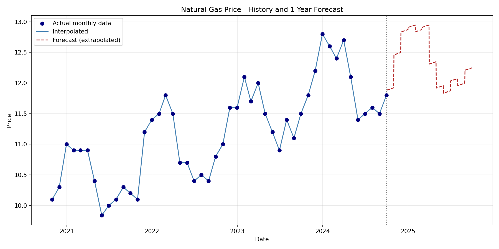
*The original Task 1 output: history, interpolation and a one-year extrapolated forecast. The research modules above test whether forecasts like this are actually accurate.*

---

## 16. Origin, independence and disclaimer

The four problem statements come from a **JPMorgan Chase Quantitative Research virtual job simulation** (completion certificate in [`docs/`](docs/JPMorgan_Chase_certificate.pdf)). The simulation supplied the tasks and the two datasets. Everything else (the audit, the `quant_research` package, the evaluation designs, the diagnostics, the tests, the registry, the dashboard, the reports and the 53 figures) is independent work built on top.

This project is **not affiliated with, endorsed by, or employment experience at JPMorgan Chase**. It is a research and learning project; nothing here is investment, trading or lending advice. The storage prices are illustrative assumptions and the loan results should not be read as evidence of real-world model performance.

---

<div align="center">

**Author:** [Dharmi Sapariya](https://github.com/DharmiSapariya)

*If something in this repository can't be traced to a CSV and a command, that's a bug. Open an issue.*

</div>
