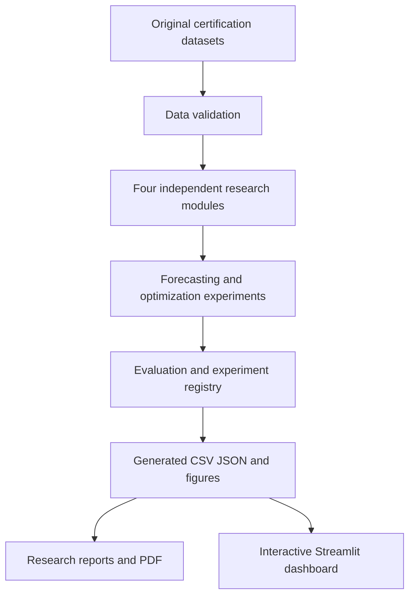

# Architecture

Original certification scripts are retained in `task1_*` through `task4_*` folders. The `quant_research` package provides independent implementations. `quant_research.phase2` generates additional diagnostics from real outputs.
